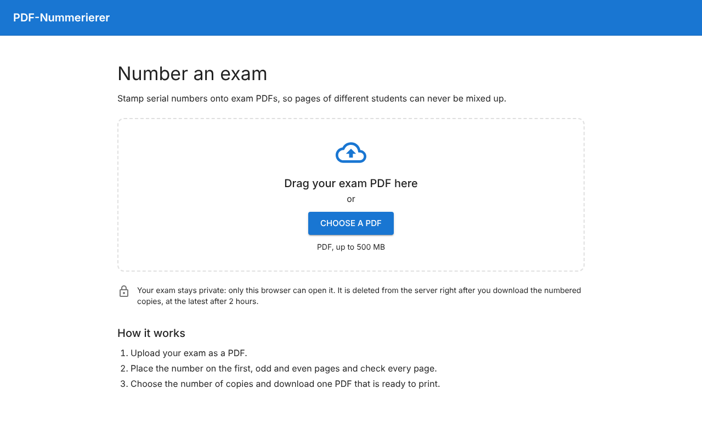
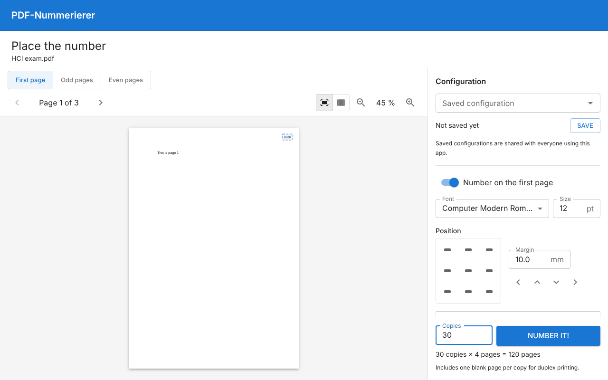
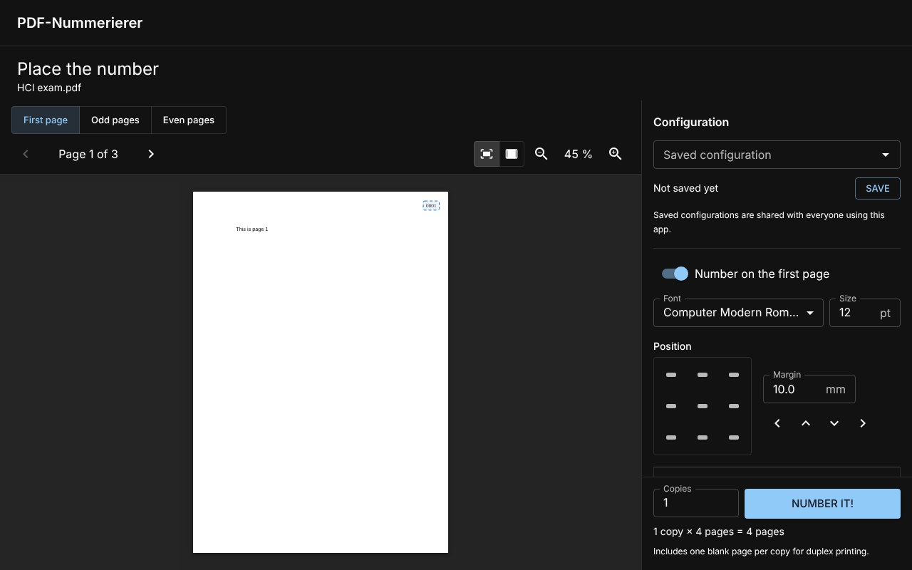
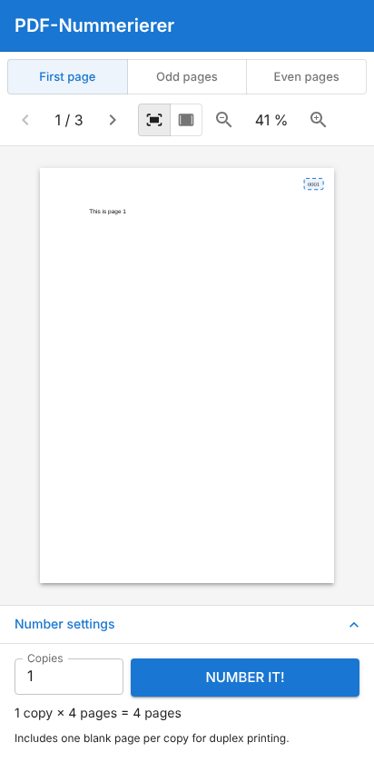

# PDF-Nummerierer

A web application that stamps serial numbers onto exam PDFs, so the pages of a
multi-page exam can never be mixed up between students. Upload the exam, place
the number visually on the first, odd and even pages, choose how many copies you
need and download one print-ready PDF that contains all numbered copies.

> **Status:** feature complete (work packages WP0–WP12 in
> [`docs/PLANNING.md`](docs/PLANNING.md)); runs in production as a Docker image
> behind Traefik, see [Deployment](#deployment).

## Usage



1. **Upload** your exam PDF (up to 500 MB). It is bound to your browser
   session: nobody else can see or download it.
2. **Place the number.** Choose *First page*, *Odd pages* or *Even pages* and
   click a position preset, click on the page or drag the number where you
   want it; arrow keys and exact millimetre fields fine-tune it. Each of the
   three placements is optional. Pick a font, a size and the number format
   (e.g. `Exam A – 0042`). Page through the document: the number is previewed
   live on every page, exactly where it will be printed. Uploaded the wrong
   file? **Delete PDF** above the page removes it from the server right away
   and takes you back to the upload page.
3. **Save the configuration** under a name to reuse it next semester. Saved
   configurations are visible to everyone using the app; saving under an
   existing name creates a new version and never overwrites the old one.
4. **Number it!** Enter the number of copies (up to 9999). By default every
   copy is padded to an even page count so duplex printing never puts two
   students' pages on one sheet; a switch turns this off. The joined PDF is
   downloaded.
5. After the download, the uploaded and the generated PDFs are deleted from the
   server automatically; the done screen confirms it. A **Delete now** button
   is available as well.

Uploads that are left behind are cleaned up too: an open page tells the server
once a minute that it is still in use. When the page is closed, the PDF is
deleted after 15 minutes, and in any case at the latest 2 hours after the
upload.

No account is needed. The app follows the browser's light or dark mode and
works on phones as well as on large screens.



| Dark mode | Phone |
|---|---|
|  |  |

## Repository layout

| Path | Contents |
|---|---|
| `backend/` | Django project (Python 3.14, managed with [uv](https://docs.astral.sh/uv/)) |
| `backend/stamping/` | Framework-free PDF stamping library and the bundled fonts |
| `frontend/` | React 19 + TypeScript + MUI single-page app (Vite) |
| `e2e/` | Playwright end-to-end tests against the real stack |
| `Dockerfile`, `docker/`, `docker-compose*.yml`, `.env.example` | Production image and deployment behind Traefik |
| `docs/PLANNING.md` | Architecture, security model, UX design and work packages |
| `AGENTS.md`, `CLAUDE.md` | Working rules for AI coding agents |

## Development setup

Requirements:

- [uv](https://docs.astral.sh/uv/getting-started/installation/) (it installs
  Python 3.14 automatically)
- Node.js ≥ 22.22 (the current LTS, 26, is recommended; see `.nvmrc`)
- yarn 4 via Corepack. Node 22/24 ship Corepack: run `corepack enable`. From
  Node 25 on, install it first: `npm install --global corepack && corepack enable`.
- GNU make

Install everything:

```bash
make install
```

After pulling new commits, the `make` targets install new dependencies by
themselves: frontend packages whenever `yarn.lock` or a `package.json` changed,
Python packages through `uv run`. If you call `yarn` directly instead, run
`yarn install` first.

Start backend (http://127.0.0.1:8000) and frontend (http://localhost:5173)
together, then open http://localhost:5173:

```bash
make dev
```

The Vite dev server proxies `/api` to Django, so the browser sees a single
origin exactly like in production. `make dev` runs Django with
`PDFNUM_DEBUG=1`; its database and files live in `backend/var/`.

Run `make help` to list all tasks.

## Running the tests

This project is developed test-first (see [`AGENTS.md`](AGENTS.md)).

Backend tests (pytest + pytest-django):

```bash
make test-backend
```

Frontend tests (Vitest + React Testing Library):

```bash
make test-frontend
```

Both suites at once:

```bash
make test
```

Linters, formatting checks and type checks (ruff, Prettier, ESLint, tsc):

```bash
make lint
```

Auto-format all code:

```bash
make format
```

### End-to-end tests

The Playwright tests start their own Django server (port 8765, fresh database
in `e2e/.data/`) and a production build of the frontend (port 4173) and run in
Chromium (desktop and phone), Firefox and WebKit (Safari engine; desktop and
iPhone). They cover the whole flow from upload to the
deleted download, privacy between browsers, both colour schemes, and that the
number in the preview lands exactly where it is printed (PDFs are inspected
with the backend's Python environment, so run `make install` first):

```bash
make e2e
```

`make install` and `make e2e` download the Chromium, Firefox and WebKit builds
that match the installed Playwright version automatically (a no-op when they
are already there, and after a Playwright update they fetch the new ones).

To run only some engines, list them in `E2E_BROWSERS` (`chromium`, `firefox`,
`webkit`):

```bash
make e2e E2E_BROWSERS=chromium,webkit
```

If a browser then fails to start because system libraries are missing
(`error while loading shared libraries`), install them once (Debian/Ubuntu,
asks for your sudo password):

```bash
make e2e-deps
```

The same suite against gunicorn serving the built app, exactly as in the
Docker image (WhiteNoise, app shell, Content Security Policy):

```bash
make e2e-production
```

Everything CI runs (lint, unit tests, e2e):

```bash
make check
```

If your machine already has a Chromium that does not match the Playwright
version (for example in a container image), point Playwright at it instead of
downloading one:

```bash
PLAYWRIGHT_CHROMIUM_EXECUTABLE_PATH=/path/to/chrome make e2e
```

Single backend test files or frontend tests in watch mode:

```bash
cd backend && uv run pytest pdfnum/tests/test_settings.py -v
```

```bash
yarn workspace frontend test:watch
```

## Configuration

The backend is configured with environment variables:

| Variable | Default | Meaning |
|---|---|---|
| `PDFNUM_SECRET_KEY` | — (required unless debug) | Django secret key; use a long random value |
| `PDFNUM_DEBUG` | `0` | `1` enables Django debug mode (development only) |
| `PDFNUM_ALLOWED_HOSTS` | `localhost,127.0.0.1` | Comma-separated host names the app is served under |
| `PDFNUM_DATA_DIR` | `backend/var` | Directory for the SQLite database and uploaded/generated PDFs |
| `PDFNUM_SECURE_COOKIES` | on unless debug | Send session and CSRF cookies only over HTTPS |
| `PDFNUM_MAX_UPLOAD_BYTES` | `524288000` (500 MB) | Largest PDF that can be uploaded |
| `PDFNUM_RETENTION_SECONDS` | `7200` (2 hours) | Uploaded and generated PDFs are deleted at the latest after this time; also the session lifetime |
| `PDFNUM_IDLE_SECONDS` | `900` (15 minutes, at least 120) | An upload whose page was closed (no keep-alive from the browser for this long) is deleted early |
| `PDFNUM_UPLOAD_RATE` | `60/hour` | Uploads allowed per client IP (`N/second`, `N/minute`, `N/hour`, `N/day`) |
| `PDFNUM_CONFIG_SAVE_RATE` | `60/hour` | Saved configurations allowed per client IP (same format) |
| `PDFNUM_MAX_COPIES` | `9999` | Most copies per run |
| `PDFNUM_MAX_OUTPUT_PAGES` | `100000` | Most pages in one generated PDF (copies × pages per copy); bounds memory use |
| `PDFNUM_GENERATION_WORKERS` | `2` | Generation jobs running in parallel per server process |
| `PDFNUM_GENERATION_RUNNER` | `thread` | `thread` (background thread pool) or `immediate` (inside the request; tests only) |
| `PDFNUM_JOB_TIMEOUT_SECONDS` | `1800` | Jobs without progress for this long are reported as interrupted |
| `PDFNUM_TRUST_PROXY` | `0` | `1` behind a TLS-terminating reverse proxy such as Traefik: trust `X-Forwarded-Proto` and one `X-Forwarded-For` entry |
| `PDFNUM_HSTS_SECONDS` | `0` | Send `Strict-Transport-Security` for this many seconds (0 = off) |
| `PDFNUM_CSRF_TRUSTED_ORIGINS` | — | Comma-separated extra origins allowed to send forms (normally not needed) |
| `PDFNUM_FRONTEND_DIR` | `frontend/dist` | Built frontend served by Django in production |

Boolean variables accept `1/0`, `true/false` or `on/off`.

### Cleanup

Expired uploads and generated PDFs are removed by a periodic job. Run it every
few minutes (the Docker setup will schedule it):

```bash
cd backend && uv run python manage.py cleanup
```

It deletes expired documents (older than the retention time, or abandoned:
no keep-alive for `PDFNUM_IDLE_SECONDS`) with their generated PDFs, expired sessions and
abandoned temporary files, and reports generation jobs that were interrupted
(for example by a server restart).

## Updating dependencies

After every update run `make check` and commit the changed lock files
(`backend/uv.lock`, `yarn.lock`).

### Backend (uv)

Show outdated packages:

```bash
cd backend && uv tree --outdated --depth 1
```

Upgrade everything within the version ranges in `backend/pyproject.toml`:

```bash
cd backend && uv lock --upgrade && uv sync
```

Move to a new feature release (ranges are pinned to one Django series on
purpose, so read its release notes first), e.g.:

```bash
cd backend && uv add "django>=6.2,<6.3"
```

To move to a new Python version, change `backend/.python-version` and
`requires-python` in `backend/pyproject.toml`, then run `uv sync`.

### Frontend and e2e (yarn)

Interactively choose upgrades (including new major versions) for all
workspaces:

```bash
yarn upgrade-interactive
```

Or upgrade packages by name pattern, e.g. all MUI packages:

```bash
yarn up '@mui/*'
```

Update yarn itself (rewrites the `packageManager` field in `package.json`):

```bash
yarn set version stable
```

Notes:

- After upgrading `@playwright/test`, the next `make e2e` fetches the
  matching browser automatically.
- TypeScript is held at 6.0.x until `typescript-eslint` supports TypeScript 7
  (check its `typescript` peer dependency range before upgrading).
- `@types/node` follows the oldest supported Node.js major (22), so the code
  only uses APIs available there.

### GitHub Actions

The workflow in `.github/workflows/ci.yml` pins action versions; bump them
when new major versions are released.

## Deployment

The app ships as one Docker image: Django under gunicorn, serving the built
frontend itself. `docker-compose.prod.yml.example` runs it behind
[Traefik](https://traefik.io/), which terminates TLS. A second container from
the same image runs the cleanup every five minutes.

### Set up

Requirements: Docker with Compose, and a running Traefik that watches Docker,
with an HTTPS entrypoint and a certificate resolver.

1. Copy the example compose file and settings, then fill in the settings:

   ```bash
   cp docker-compose.prod.yml.example docker-compose.yml
   ```

   ```bash
   cp .env.example .env
   ```

   Both copies are ignored by git, so `git pull` never conflicts with them.

   At least `PDFNUM_HOST`, `PDFNUM_ALLOWED_HOSTS`, `PDFNUM_SECRET_KEY` and the
   three `TRAEFIK_*` values (network, entrypoint and certificate resolver of
   your Traefik). A secret key can be generated with:

   ```bash
   python3 -c "import secrets; print(secrets.token_urlsafe(50))"
   ```

2. Build and start:

   ```bash
   docker compose up -d --build
   ```

3. Open `https://<PDFNUM_HOST>/`.

### Traefik settings for large uploads

Exams can be up to 500 MB. Two Traefik settings matter:

- **Read timeout.** Traefik's entrypoints cut off requests that take longer
  than 60 seconds to read by default, which a large upload on a slow connection
  can exceed. Raise it in Traefik's static configuration, e.g.:

  ```yaml
  entryPoints:
    websecure:
      transport:
        respondingTimeouts:
          readTimeout: 600s
  ```

- **Body size.** Traefik does not limit request bodies by default. If you use
  a buffering middleware anyway, set its `maxRequestBodyBytes` to at least
  `525336576` (500 MB plus 1 MB for the form data). The app itself refuses
  larger uploads.

The compose file sets `PDFNUM_TRUST_PROXY=1`: Django then trusts Traefik's
`X-Forwarded-Proto` (HTTPS detection) and exactly one `X-Forwarded-For` entry
(the client IP for rate limiting). Only use it when the app is reachable
exclusively through the proxy, which is the case in this setup (the container
publishes no port).

### Running it

- **Data**: the `data` volume holds the SQLite database (saved
  configurations), uploads and generated PDFs while they exist, and the
  rate-limit cache. Back it up for the saved configurations; uploads and
  outputs are deleted within the retention time anyway.
- **Update** to a new version:

  ```bash
  git pull
  ```

  ```bash
  docker compose up -d --build
  ```

  Database migrations run automatically when the app container starts.
- **Logs**:

  ```bash
  docker compose logs -f web
  ```

- **Size**: `GUNICORN_WORKERS` processes (default 2), each running up to
  `PDFNUM_GENERATION_WORKERS` generation jobs (default 2). A job for 100,000
  output pages needs about 1 GB of memory.
- **Security checks**: `python manage.py check --deploy` inside the container
  warns that `SECURE_SSL_REDIRECT` is off; that is intended, Traefik redirects
  HTTP to HTTPS. `PDFNUM_HSTS_SECONDS` enables HSTS: start with a small value
  and raise it to a year once HTTPS works.

### Deploying with your own tooling (Ansible etc.)

If you template the compose file into your own deployment tool, keep these
points from `docker-compose.prod.yml.example`:

- **`pull_policy`.** The image is built on the server, not pulled from a
  registry. The `web` service has `pull_policy: build` and `cleanup` has
  `pull_policy: never`, so `docker compose pull` (for example Ansible's
  `community.docker.docker_compose_v2_pull`) skips them instead of failing with
  `pull access denied for pdf-nummerierer`.
- **Building.** `docker compose up --build` (or `create`, or Ansible's
  `docker_compose_v2` with `build: always`) builds the `web` image from the
  `Dockerfile`, and `cleanup` uses the same image tag. A separate image build
  step is not needed; if you keep one, it has to produce the tag the compose
  file uses (`pdf-nummerierer:latest`).
- **Data directory.** If you bind-mount a host directory to `/data` instead of
  using the named volume, it must be writable by uid 1000 (the `pdfnum` user in
  the image), e.g. `chown 1000:1000 data`. A `data` directory next to the
  `Dockerfile` is excluded from the build context and ignored by git, as is a
  generated `docker-compose.yml`.
- The `TRAEFIK_*` variables are only used for the Traefik labels; the
  containers themselves do not need them.

### Try the image locally

Without Traefik, on http://localhost:8000:

```bash
cp docker-compose.prod.yml.example docker-compose.yml
```

```bash
cp .env.example .env
```

Set `PDFNUM_SECRET_KEY` in `.env`, then:

```bash
docker compose -f docker-compose.yml -f docker-compose.local.yml up --build
```

The end-to-end tests can run against any deployment. Give it a high upload
rate first (`PDFNUM_UPLOAD_RATE=1000/hour`), the suite uploads many PDFs:

```bash
E2E_BASE_URL=http://localhost:8000 make e2e
```

## License

GNU General Public License v3.0, see [`LICENSE`](LICENSE).

The bundled fonts keep their own licenses (mostly SIL Open Font License), see
[`backend/stamping/fonts/README.md`](backend/stamping/fonts/README.md).
